# MascotRL

You buy a fund because of a sentence on the first page. It chases what has been rising. It buys what just fell. It stays quiet when the market gets loud. That sentence is why the page exists. You can hold it up to the stocks in the fund and ask whether they look like the words.

A learning machine skips the sentence. Each morning it returns a list: this much in this stock, that much in the next, and a number for how the day went. Chase, fade, or hide. The list does not say. This repository is the reading of that list.

## What you can check here

This repository does three things.

It files a finished list of holdings under one of six habits, with the name locked before the count. A book that sits too close to an even split stays unnamed.

It keeps the same toll in the morning the book learns and on the path a reader later opens. Five basis points, five cents on a hundred dollars moved.

It leaves the small maps in `src/` so a reader can rerun the naming, the toll, and the screen without the trainer.

Of 106 books that already carried a design name, the later reading agrees on the strict rule 7 times. No tested book is offered as a beat of a same-cost benchmark.

## One body, then a name

Every book in the study uses the same body. The habit is the name a frozen scorecard files from the holdings after the path exists.

Yesterday's news comes in first, and nothing from today is allowed in. The previous weights come with that news, because a toll makes tomorrow depend on what you already hold. A torso turns that intake into one hunch per stock. A higher hunch means the book wants more of that name. The hunch is not yet a holding.

A collar turns the hunches into shares of one fund. The shares are zero or positive, and they add to the whole. Three collars are in the public code. One can leave a stock at zero. One leaves every stock a crumb. One caps each score and then fills the fund again. On 60 books, 20 for each collar, the dense collar has concentration 0.040 and one-way turnover 0.068, the sparse collar 0.413 and 0.443, and the bounded collar 0.011 and 0.047. The collar moves the shape of the book. The five-path Sharpe ratios beside those figures are context.

A heart grades the day after the toll. The book is taught on that grade. A tail charges five basis points on the full change in weights, in training and again on the path you read. If the toll were added only after training, the book would learn a day it is not later charged for. A spine carries the grade back, so the next morning's map can change.

The name is none of those parts. If the leading habit does not clear the runner-up by 0.25, the filing is generalist. The filed name can disagree with the name the training file asked for. That disagreement is what the rest of this note counts.

## Six habits

A cheetah adds to what has already been moving the same way, and it cuts what has not. A fox sells what ran up and buys what fell. A tortoise keeps the day's risk small and prefers the quiet names. A magpie puts almost all the money on the loudest score, so one stock can be nearly the whole book. A hummingbird turns the list over often, and the toll is part of that habit. An owl is the filing when no habit leads the runner-up by 0.25. The scores sit close together, so the reading stays general.

Of 179 books that cleared the screen, the reading named 11 cheetahs, 32 foxes, 18 tortoises, 21 magpies, 19 hummingbirds, and 78 owls. The six counts add to 179. The owl is the largest filing.

## The screen

The screen asks a plain question. If you split the fund into the same slice of every stock, how far is this list from that split?

The distance is the mean absolute gap versus that even split. Active share is half of that gap. The screen withholds the name when the mean absolute gap is below 0.25, which is an active share of 12.5 percent. The name stays off, and the book is not counted among the 179.

Eight contrarian books use a shorter calendar, 1,485 days from 4 January 2019, and they omit 24, 27, and 28 February 2020 and 9, 12, 16, and 23 March 2020. They stay in the holdings count. They stay out of any performance sentence.

## The name that was written first

Training began with a design: chase, fade, keep risk small, crowd into one name, or keep turning over. That design is a name written before the path exists.

Of 106 books that already had a design name, the later reading agreed on the strict rule 7 times. Twenty-five of these 106 share the designed label and the filed label. The strict match is the tighter rule.

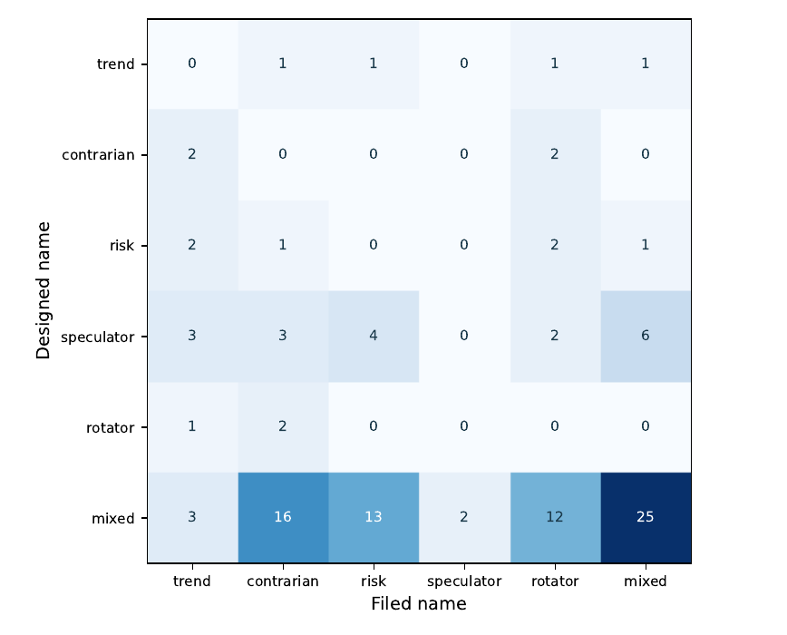

Each cell is a count. The rows are the name the design carried. The columns are the name the scorecard filed. The diagonal of the five named habits is empty. The 25 books that share a label sit in the residual cell, filed here as mixed, which is the owl in the census. The strict match of 7 is a tighter rule than sharing that label.

## Where those 106 books sit

The 106 are not the census of 179. They are the books that already carried a design name. The legend on the next picture is the name the scorecard filed for those 106: 11 trend, 23 contrarian, 18 risk, 2 speculator, 19 rotator, and 33 mixed. Those six numbers add to 106. They are not the 11, 32, 18, 21, 19, and 78 of the census. A reader who mixes the two tables will think the study found two speculators. The census found 21.

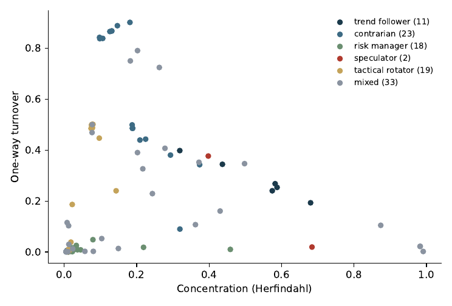

Concentration is the Herfindahl of the weights. One-way turnover is half the sum of absolute weight changes. The two books filed as speculator sit toward high concentration, and one of them barely turns over. The risk managers sit in a tight knot at low concentration and low turnover. The contrarians are the high cloud: several of them turn over more than half the book and are not especially concentrated. Trend followers stretch from a concentrated book that still trades to a book that is mostly one name and quieter. Mixed books appear in every region. The habit name and the cloud are related. They are not the same point.

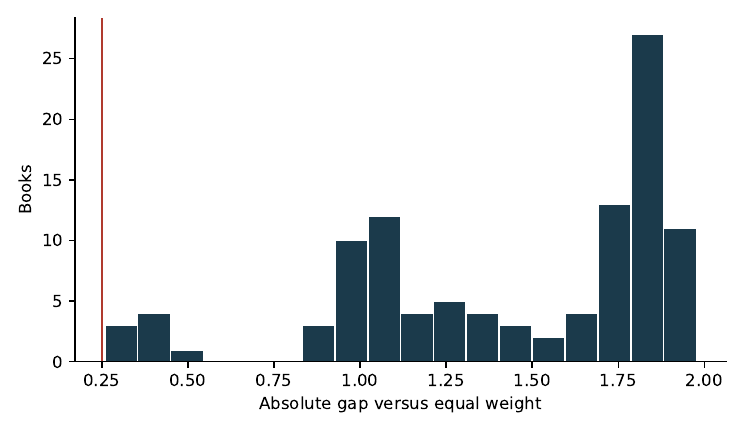

The vertical line is the screen, at a gap of 0.25. Every book in this picture clears it, which is why these 106 are in the designed-name count. The mass is not piled against the line. A handful sit just to the right of 0.25. Then a gap. Then a block around a gap of 1, and a taller block near 1.75 to 2, which on 100 names is close to holding a few stocks and leaving the rest empty. Clearing the screen is common in this cut. Hugging the screen is not.

## The collar decides the shape

On 60 books, one network and one torso, the grade inside a collar barely moves the turnover. The median one-way turnover shifts by about 0.001 when the grade changes inside softmax, by about 0.004 inside bounded tanh, and by about 0.066 inside the sparse collar. The collars themselves sit near 0.068, 0.047, and 0.43. Lag-1 autocorrelation of the weights stays near 0.92, 0.60, and 0.41. Changing the grade is not a change of the collar. The collar is what separates those books.

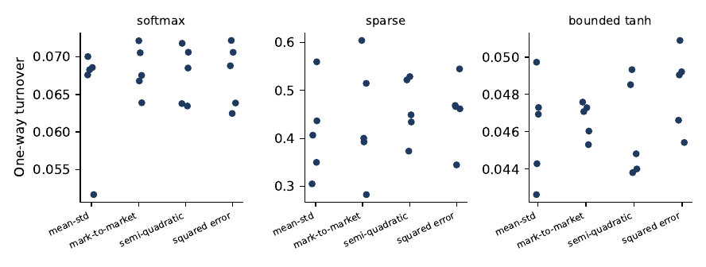

Read the vertical scales before comparing panels. Softmax lives between about 0.05 and 0.07. Bounded tanh lives between about 0.044 and 0.052. The sparse collar lives between about 0.28 and 0.60. A seed moves inside its panel. It does not jump from one panel into another. The grade names on the horizontal axis are mean-variance, mark-to-market, a semi-quadratic penalty, and a squared error. Four grades, three clouds, and the clouds do not overlap.

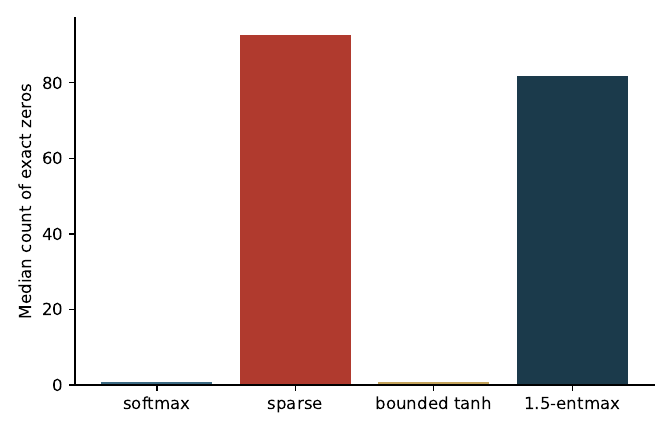

The count is the mean over every tenth day of the stored path, then the median across books with that collar. Softmax and bounded tanh sit on the axis: those collars almost never write an exact zero. The sparse collar parks most of a hundred names at zero. The 1.5-entmax collar does the same, a little less extremely. A book can still be concentrated with a softmax collar. The speculator sheet is that case: the collar is softmax, so it writes no exact zero, and the concentration of the stored weights is still 0.99, because the hunches that reach the collar are already peaked.

Matched twins keep the rest of the design and swap the collar. On 58 pairs the gap in absolute distance from an even split, sparse minus softmax, has median 1.673. A paired test on those 58 gives p = 1.75e-11. The twins are not the census, and they are not a regression of habit on design. They are the same book asked to write weights two ways.

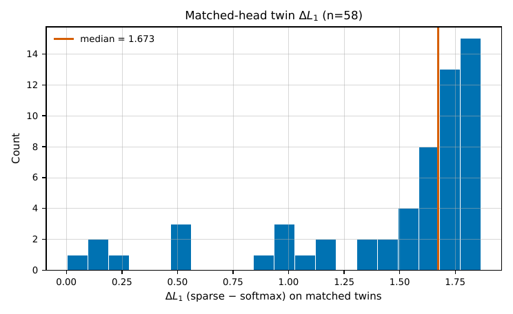

Most of the pairs pile up between about 1.5 and 1.9. A few pairs sit near zero, so the swap does not move every book. The center of the picture is a large move. Leaving names at zero, rather than leaving every name a crumb, is what pushes the list away from an even split.

## One morning in March 2019

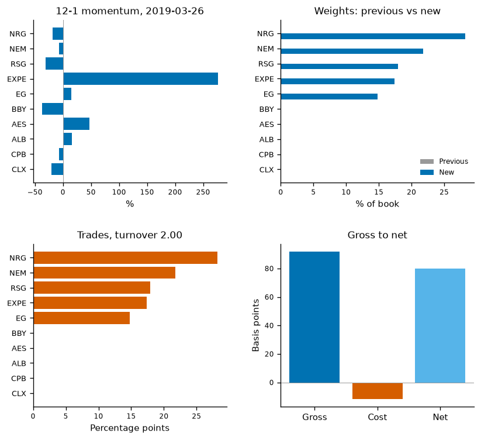

26 March 2019 is the highest-turnover day in 2018 and 2019 on which the previous book was already invested, for one trend-follower book. The book bought five names from a weight of zero. The same five firms occupied those slots on 25 March, so the change is a trade: NRG Energy 0.282, Newmont 0.218, Republic Services 0.179, Expedia 0.174, and Everest Group 0.148.

Expedia's twelve-minus-one return that day is 2.762. Everest Group's is 0.152. NRG Energy, Newmont, and Republic Services, at -0.181, -0.075, and -0.310, were not winners on that clock. A momentum desk would add Expedia. This book also bought the three losers. Gross that day is 91.9 basis points, cost is 11.8, and net is 80.1. That day's net is not the path.

The training file asked for a risk manager. The holdings filed a trend follower. Active share that day is about 0.94, against a screen of 12.5 percent, so the name is allowed. The path is not offered as a beat of an even split.

## One morning in August 2024

On 1 August 2024 a dense book, taught on a differential Sharpe grade, was long all 100 names. The largest weight was 0.113. The sum of absolute weight changes was 0.655, against a book-average one-way turnover of 0.016. The book-average distance to an even split is 0.067, inside the screen. The configuration was built as a trend follower. The label stored with the book is unnamed. The screen did its job: the list was too close to the same slice of every name, so the habit stayed off.

The same day, a sparse book taught on the same grade held one name at full weight and left the other ninety-nine empty. The turnover cap did not bind on either book. Neither day is the median day of its book.

## The bill for changing the book

The configured charge is five basis points on the full change in weights, in training and again on the path. A charge at that rate would have sat near five. What showed up was higher, and it differed by collar.

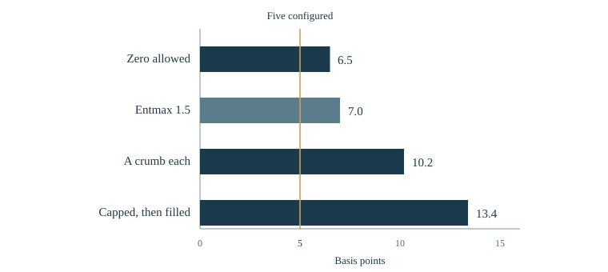

These are the median costs that showed up, in basis points, next to the five that were configured. The bars are a bill for changing the holdings. The sample is 105 books. The gold line is the five, drawn through the bars so the gap is visible, with the label kept above the plot.

When a stock can be left at zero, the median was 6.5 basis points. Entmax 1.5, which can also leave names empty, sat near 7.0. When every stock keeps a crumb, the median was 10.2. When each score is capped and the book is filled again, it was 13.4. A few softmax and bounded-tanh books sit near 120 basis points. They are not the center of the bars. The behaviour card reports one-way turnover, about half the full change, so the same cost per unit of that card's turnover is about twice the figure. The collar that writes zeros is the cheaper bill. The collar that keeps a crumb, and the collar that caps and refills, move more weight and pay more.

## What one dollar became

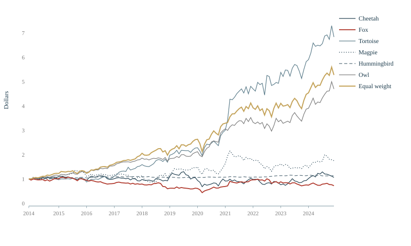

Each line starts as one dollar in January 2014 and shows what that dollar became through December 2024, after the toll when the book changes its holdings. Gold is an even split of the same stocks.

Five of the coloured lines are the stored path with the highest compounded net for that habit. The owl line is the path the file stored, not a path picked for its ending dollars. Gold was not picked as a best path. Ending dollars, rounded to the cent: tortoise 6.83, even split 5.27, owl 4.70, magpie 1.75, hummingbird 1.15, cheetah 1.07, fox 0.72.

A line that finishes above the gold line was selected because its compounded net was the highest stored path for that habit. The personalities are not ordered by that return. None of the six pictured books beats the equal-weight book on that same charge.

## A book of 400 names

Three books were trained on a width of 400 names and sit outside the census of 179. The style matrix does not cover them, which is why they are not in the six counts. They are a check on two choices the census cannot see: the torso, and whether the book changes every day or once a month. One book uses a plain network. One uses a transformer. One uses a transformer and changes once a month.

On the stored daily path, a typical day holds 372 of those 400 names. Mean concentration is 0.004. An even split of 400 names sits at 0.0025. Mean one-way turnover is 0.022. The monthly book holds 295 names on a typical day, with mean concentration 0.009 and mean one-way turnover 0.013. On every tenth day the share of names at exact zero is 0.10 for the two daily books and 0.29 for the monthly book. The pictured trend follower, by contrast, has turnover 0.27 and concentration 0.58. The 400-name books stay spread out.

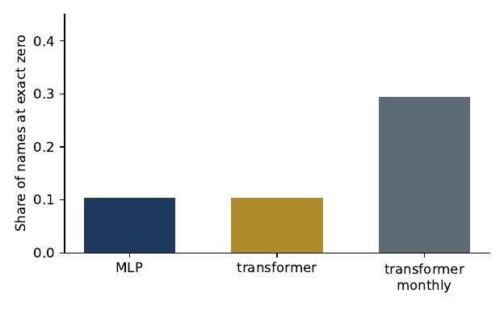

The two daily bars are the same height. The monthly bar is about three times as tall. Waiting a month to trade leaves more names at zero. It does not turn the book into the one-name sparse book from 1 August 2024.

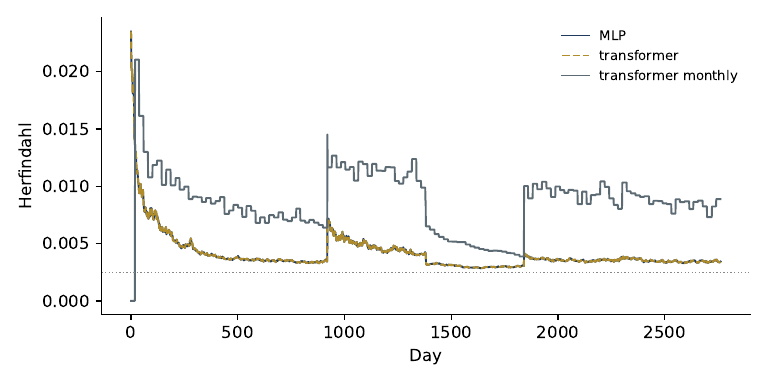

The dotted line is an even split of 400 names, at 0.0025. After the first sessions, the plain network and the daily transformer lie on top of each other, just above that line. The monthly book stays higher, mostly between about 0.008 and 0.012, with a stretch in the middle of the sample where it steps down toward the daily books and then steps back up. The two daily torsos stored the same holdings. A different torso did not write a different list. A different calendar did.

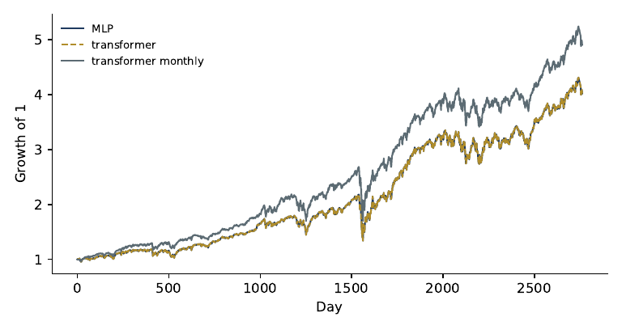

The dashed line sits on the solid line because those two books are the same stored path. The third line is the monthly book. The picture is that coincidence, and the gap between a daily change and a monthly change. It is not a test against an even split, and these three books are not in the census.

A cap of 100 names appears on the site when a visitor scores their own file. That cap is not the trained path. The trained daily book holds 372 names on a typical day.

## How the sample was cut

Evaluation uses purged combinatorial cross-validation: many train and test splits, with a gap so a label near the boundary cannot leak into training. It is not walk-forward. Nested walk-forward is a different procedure, and this project does not relabel one as the other. The state the book may see is lagged.

## How to look

The pages are at [https://zauberstern.github.io/MascotRL/](https://zauberstern.github.io/MascotRL/).

[Home](https://zauberstern.github.io/MascotRL/) is this reading, with the six habits and the counts.

[Staff the years](https://zauberstern.github.io/MascotRL/desk.html) lets you hand each year to one habit and read the dollars, next to an even split of the same stocks. The paths are the ones in the dollar figure above.

[Yesterday's clues](https://zauberstern.github.io/MascotRL/cube.html) opens one past day as a block of numbers. You can see what the book was allowed to know. A long window is empty early in the sample, because the history it needs has not arrived.

[Try your own stocks](https://zauberstern.github.io/MascotRL/book.html) takes a file of your prices and returns a list for one day. The list is a reading of that file. The page also walks the stored 400-name book: names held, zeros, concentration, and how much of the book changes hands.

The working paper is linked from the top of the site: [the PDF](https://zauberstern.github.io/MascotRL/paper/xai_portfolio_rl.pdf).

## What you can run

The licence is MIT. See `LICENSE`.

The small Python in `src/` is the part a reader can check without the trainer.

`state.py` builds the lagged intake: yesterday's features and the previous weights.

`heads.py` turns hunches into shares. Softmax leaves every name a crumb. Sparsemax can leave a name at zero. Bounded tanh caps each score and fills the fund again.

`cost.py` charges five basis points on the full change in weights.

`gate.py` measures the gap versus an even split and withholds the name when that gap is below one quarter.

`scorecard.py` files one of the six names. If the lead over the runner-up is below 0.25, the filing is generalist.

The tests live in `tests/test_public.py`. From the repository root, with numpy and pytest installed:

```bash
pytest -q
```

The pictures in this note are committed files under `site/assets/`. The tests do not redraw them.

If you use the reading, cite it with `CITATION.cff`.

## What is not here

The trainer is not in this repository. The market files are not here. The weight matrices are not here. The code that taught the books is not here. There is no account, no broker, and no live book. Vendor panels are not redistributed. The site ships the fixtures the four pages need, and nothing wider.

Results are backtested and are not investment advice.

Silhouettes: Michaud, Sayol, Mauel, Jablunovsky, Sayol, Sayol. PhyloPic, CC0.
